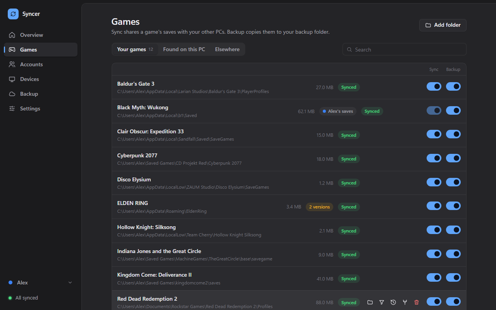
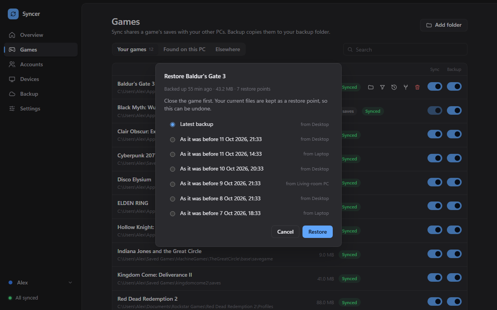
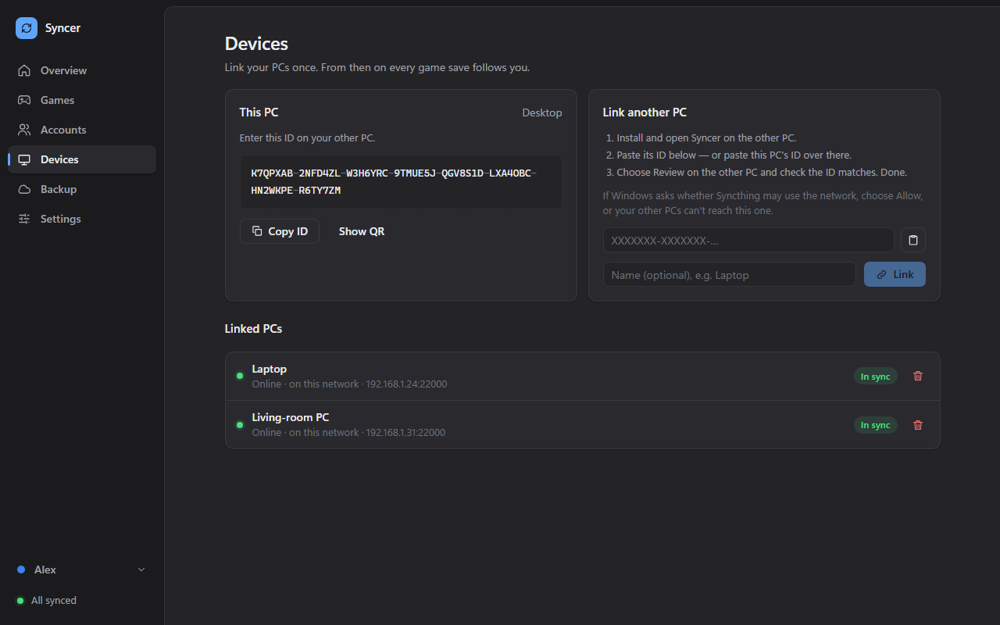

<p align="center"></p>

<h1 align="center">Syncer</h1>

<p align="center">Keep your PC game saves in sync between your Windows PCs, with a versioned backup in a folder you choose, such as Google Drive.</p>

<p align="center">
  <a href="https://github.com/ApolloF/syncer/releases/latest"></a>
  <a href="LICENSE"></a>
  <a href="https://github.com/ApolloF/syncer/actions/workflows/build.yml"></a>
</p>

<p align="center"></p>

**[Download Syncer](https://github.com/ApolloF/syncer/releases/latest/download/Syncer-amd64-installer.exe)** for Windows 10 and 11 (64-bit). Free and open source, no account, no telemetry.

- Finds the saves of about 14,000 games on its own and syncs them between your PCs, end-to-end encrypted.
- Keeps a versioned backup in any folder, for example your Google Drive for desktop folder, OneDrive, a NAS share or an external drive, with restore points you can roll back to.
- With two PCs linked, each holds a full copy of your saves, so you have two copies even before you set up a backup.
- Only one PC? Syncer works as a backup on its own: versioned copies of your saves in your Google Drive for desktop folder or any other folder.
- Never overwrites a save behind your back: when two PCs changed the same save, you pick which one to keep.
- Leaves what Steam Cloud, OneDrive and Ubisoft Connect already sync to them.
- Holds syncing while a game runs, so no save changes under a running game.

| Restore any save | Link a PC with one ID |
|---|---|
|  |  |

<sub>Screenshots use made-up games and PCs.</sub>

## Why

I play on more than one PC and couldn't find anything that kept my saves in sync on its own, for every game and every store, without a cloud service in between. Steam Cloud only covers some games, and backup tools like Ludusavi back up but don't sync. So I made Syncer.

## Install

1. Download **`Syncer-amd64-installer.exe`** from [Releases](https://github.com/ApolloF/syncer/releases/latest) and run it. It installs just for your user (no admin prompt) into `%LOCALAPPDATA%\Programs\Syncer`. Prefer no installer? `Syncer.exe` from the same release is portable; keep it in a permanent folder, since the background task points at it.
2. Open Syncer. If [Syncthing](https://syncthing.net) isn't installed yet, the Overview installs it with one click (via `winget`).
3. For the backup, open *Backup*. Syncer finds [Google Drive for desktop](https://www.google.com/drive/download/) by itself; otherwise choose any folder, such as one in OneDrive, on a NAS or on an external drive. Syncer writes the backup into that folder and your cloud app uploads it. The backup is optional.
4. Your games start syncing automatically. Check *Games → Found on this PC* for anything else, such as folders Syncer didn't recognise.

Syncer isn't code-signed yet, so Windows SmartScreen may warn the first time: click *More info → Run anyway*. To check your download, compare it with `SHA256SUMS.txt` on the release page (in PowerShell: `Get-FileHash Syncer-amd64-installer.exe`), or check where it was built with the [GitHub CLI](https://cli.github.com): `gh attestation verify Syncer-amd64-installer.exe -R ApolloF/syncer`. The built-in updater also checks its downloads against the release's SHA-256. You only install once; after that Syncer updates itself (you can turn that off in Settings).

**Syncthing won't install?** The one-click install needs `winget`, which comes with current Windows 10 and 11. If it isn't available, Syncer shows an error with a link to [install Syncthing by hand](https://syncthing.net/downloads/). Syncer finds it once it's installed.

**Updating from 0.x?** If your backup used *Sign in with Google*, Syncer asks you to choose a backup folder (you get a one-time notification). Your old backup in Google Drive stays where it is. Mod folders you synced are paused and left as they are, with a one-time notice.

### Linking a second PC

1. Install Syncer on the second PC.
2. On one PC, open **Devices** and paste the other PC's ID.
3. On the other PC, choose **Review** on the request, check that the full ID shown matches the one on the first PC's Devices page, and link.

Syncer only shares your saves with PCs you linked or allowed. A PC that is already paired in Syncthing and wants to join shows up on Devices with **Allow** and **Ignore**; check its ID the same way before you allow it.

Every synced game then shows up on the other PC at the right local path, even if the user name or Documents location differs.

## How it works

Syncer is a small desktop app built on two tools that already work well:

- **Syncthing between your PCs.** Syncthing copies saves straight from PC to PC, end-to-end encrypted, with no account and no cloud storage in between. Your PCs don't need to be on the same network: when they can't reach each other directly, Syncthing's public relays pass the encrypted data along. Syncer installs and drives your own Syncthing; it doesn't bundle it.
- **A folder as the backup.** Syncer copies your saves into a `GameSaveBackup` folder inside the folder you chose (with Google Drive for desktop, `My Drive\GameSaveBackup`). Only changed files are copied, and replaced or deleted files are kept as restore points for 30 days by default. Syncer only writes into that folder on your PC; your cloud app (Google Drive for desktop, OneDrive, …) does the upload. Syncer has no Google account connection of its own.

```
 PC A                                  PC B
 ┌─────────────┐   Syncthing (P2P)   ┌─────────────┐
 │ save folders│◄───────────────────►│ save folders│
 │ syncer-meta │◄───────────────────►│ syncer-meta │  ← each PC's folder list, portable paths
 └──────┬──────┘                     └─────────────┘
        │ Syncer.exe --background (Task Scheduler)
        ▼
 <backup folder>\GameSaveBackup\<game>\…      ← mirror
 <backup folder>\GameSaveBackup\.versions\…   ← replaced/deleted files, thinned, pruned after N days
        │ your cloud app, e.g. Google Drive for desktop
        ▼
   the cloud, a NAS or an external drive
```

Syncthing only syncs while both PCs are on. The backup covers the rest: when the PC you played on last is switched off, Syncer can take the newer saves from its backup, but only when nothing on this PC can get lost.

Save locations come from the [Ludusavi manifest](https://github.com/mtkennerly/ludusavi-manifest), which is built from [PCGamingWiki](https://www.pcgamingwiki.com). A scheduled task (`\Syncer-Background`) runs the sync and backup at logon and every few hours, also when the window is closed.

All features, from Steam Cloud detection to separate saves per person, are described in [docs/features.md](docs/features.md).

## Privacy

Syncer has no server of its own, and the developer receives no data from it: no account, no telemetry, no crash reports.

- Your saves go directly between your PCs (Syncthing) and into the backup folder you chose. Syncer never connects to your Google account; if the folder is synced by Google Drive for desktop or OneDrive, that app does the upload.
- Syncthing's public discovery servers see your PCs' device IDs and IP addresses, as with any Syncthing setup. GitHub (game list, update check) and Google (time check) see your IP address, as with any web request.
- Settings and logs stay on your PC in `%APPDATA%\Syncer` and `%LOCALAPPDATA%\Syncer`.

The full policy is in [PRIVACY.md](PRIVACY.md).

## FAQ

**Can this get me banned by anti-cheat?**
Syncing saves only touches save files, the same files the game writes itself. Syncer doesn't change the game's own files and doesn't inject anything into it. Saves of online games usually live on the game's servers anyway, so there's nothing for Syncer to sync.

**Which games does it support?**
About 14,000 games whose save locations are listed on PCGamingWiki, through the Ludusavi manifest, from any store: Steam, Epic, GOG, EA, Ubisoft, Xbox, or no store at all. Games that aren't listed can be added by hand with any folder. If a game's save location is missing or wrong, fixing it on PCGamingWiki fixes it for everyone; Syncer refreshes the list every week. You can also [request a game](https://github.com/ApolloF/syncer/issues/new?template=game_request.yml).

**Why not just use Steam Cloud?**
Use it where it works: Syncer leaves folders that Steam Cloud really keeps to Steam, and checks this per folder rather than trusting the store page. Syncer is for everything else: games from other stores or no store, games without cloud saves, mod saves Steam skips (such as SKSE co-saves), and a history of restore points Steam Cloud doesn't keep.

**What happens when two PCs changed the same save?**
Syncer doesn't guess. The game shows **2 versions**, and you pick which one to keep, file by file or all of one PC's files at once. The other version goes into the backup history instead of being deleted.

**How do I restore an older save?**
On the Games page, click the history button (*Restore from backup*) next to the game. Pick the latest backup or any earlier restore point. Your current files are saved as a restore point first, so a restore can be undone.

**Does Syncer get access to my Google account?**
No. Syncer doesn't connect to Google at all (apart from an empty time check). It writes the backup into a folder on your PC; if that folder belongs to Google Drive for desktop, OneDrive or similar, that app uploads it under its own account and permissions.

**Do I need a backup folder or a cloud account?**
No. Syncthing works on its own between PCs that are on at the same time, and with two PCs linked each one holds a full copy. A backup adds restore points and lets a PC pick up saves from a PC that is switched off. It can be any folder: Google Drive for desktop, OneDrive, a NAS share or an external drive.

**My PCs are linked but don't connect.**
The first time Syncthing listens, Windows asks whether it may use the network. If that was dismissed, Windows keeps blocking it and your other PCs can't reach this one. Open *Windows Security → Firewall & network protection → Allow an app through firewall*, choose *Change settings*, and tick *Syncthing* for *Private* networks (add it with *Allow another app* if it's missing). Do this on each PC.

**How is this different from Ludusavi?**
[Ludusavi](https://github.com/mtkennerly/ludusavi) is a backup tool: you back up and restore saves, on one or more PCs. Syncer keeps saves in sync between PCs continuously, in the background, and keeps a backup with history next to that. Syncer uses Ludusavi's manifest to find saves.

**How do I stop using it?**
*Settings → Undo everything* stops all syncing on this PC and can also unlink your PCs, stop or uninstall Syncthing, and delete the backups. Then uninstall Syncer from *Windows Settings → Apps*. Your save files are never deleted.

Uninstalling alone removes only Syncer's own files. Your settings and backups stay, and Syncthing keeps running and syncing your saves, so use *Undo everything* first if you want that to stop. Folders Syncer had paused are resumed when you uninstall, if Syncthing is running then.

## Limitations

- **Windows 10 and 11 only (64-bit).** No macOS, Linux or Steam Deck version.
- **Not code-signed yet**, so SmartScreen warns on the first run.
- **The backup is a folder on this PC.** Any folder works, including one that Google Drive for desktop, OneDrive or a NAS keeps, but Syncer doesn't talk to cloud services itself and has no WebDAV or other direct upload.
- **Syncthing needs both PCs on at the same time.** Saves from a PC that is off arrive through the backup only when that PC's backup has fully reached the shared backup folder.
- **Saves stored in the Windows registry aren't synced**, only save files and folders.
- **One PC at a time.** Changes from your other PCs wait while a game runs. Playing the same game on two PCs at once ends in *2 versions* for you to sort out.
- **English only.**
- **No mod sync.** Syncer syncs saves only.

## Report a problem

[Open an issue](https://github.com/ApolloF/syncer/issues/new/choose). The activity log is under *Settings → Activity log*, and the full log file is `%APPDATA%\Syncer\syncer.log`. If Syncer crashed, the details are in `crash.log` in the same folder. Please add your Syncer version (bottom of *Settings*) and Windows version. Logs can contain game names and folder paths (with your Windows user name), so check them before you post. See [CONTRIBUTING.md](CONTRIBUTING.md) if you'd like to help.

## Develop

Requirements: Go 1.26+, Node 22+, [Wails v2](https://wails.io) (`go install github.com/wailsapp/wails/v2/cmd/wails@v2.16.0`).

```bash
wails dev          # live-reloading app
go test ./...      # backend tests
go test -tags personal ./...   # the same tests for the personal build
wails build        # build/bin/Syncer.exe
```

`wails build` makes the public release: no mods, no Google sign-in and no launcher integration, switched off at compile time (see [Builds in CONTRIBUTING.md](CONTRIBUTING.md#builds-public-vs-personal)). `wails build -tags personal` makes the maintainer's personal build with all of those on; it never installs the public release over itself. Google sign-in in a personal build needs a Google OAuth client id and secret passed at build time (`-ldflags "-X main.gdriveClientID=… -X main.gdriveClientSecret=…"`); without them it is hidden. Releases from CI are always the public build.

The backend lives in `internal/`: `syncthing` (REST client), `meta` (cross-PC folder sharing), `discover` (manifest, scan, installed games), `backup` (mirror/versions/restore), `gdrive` (Google sign-in and Drive sync, personal build only), `features` (public/personal switches), `tasks` (Task Scheduler), `paths` (portable paths, sync safety rules) and `winx` (Windows priority, full-screen and foreground checks). The Svelte 5 frontend is in `frontend/src`. Draft winget and Scoop manifests are in [packaging/](packaging/).

## License

Syncer is free software: you can redistribute it and/or modify it under the terms of the [GNU Affero General Public License v3.0](LICENSE). It comes with no warranty. The third-party code it includes is listed, with its licenses, in [THIRD_PARTY_NOTICES.md](THIRD_PARTY_NOTICES.md).

Game save locations come from the [Ludusavi manifest](https://github.com/mtkennerly/ludusavi-manifest), which is built from [PCGamingWiki](https://www.pcgamingwiki.com) (CC BY-NC-SA 3.0). Syncer downloads it at runtime and doesn't include it. Syncing is done by [Syncthing](https://syncthing.net) (MPL-2.0), installed separately.

Syncer is not affiliated with Valve, Google, Microsoft or the Syncthing Foundation. Syncthing is a trademark of the Syncthing Foundation; Google Drive is a trademark of Google LLC.
